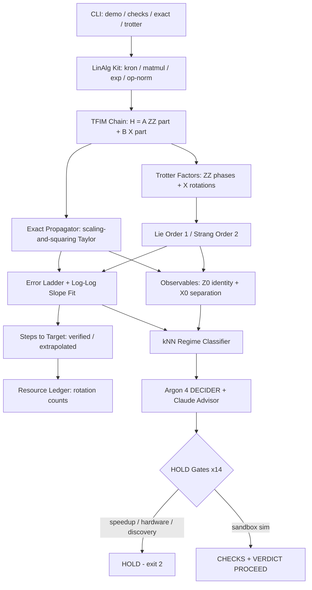
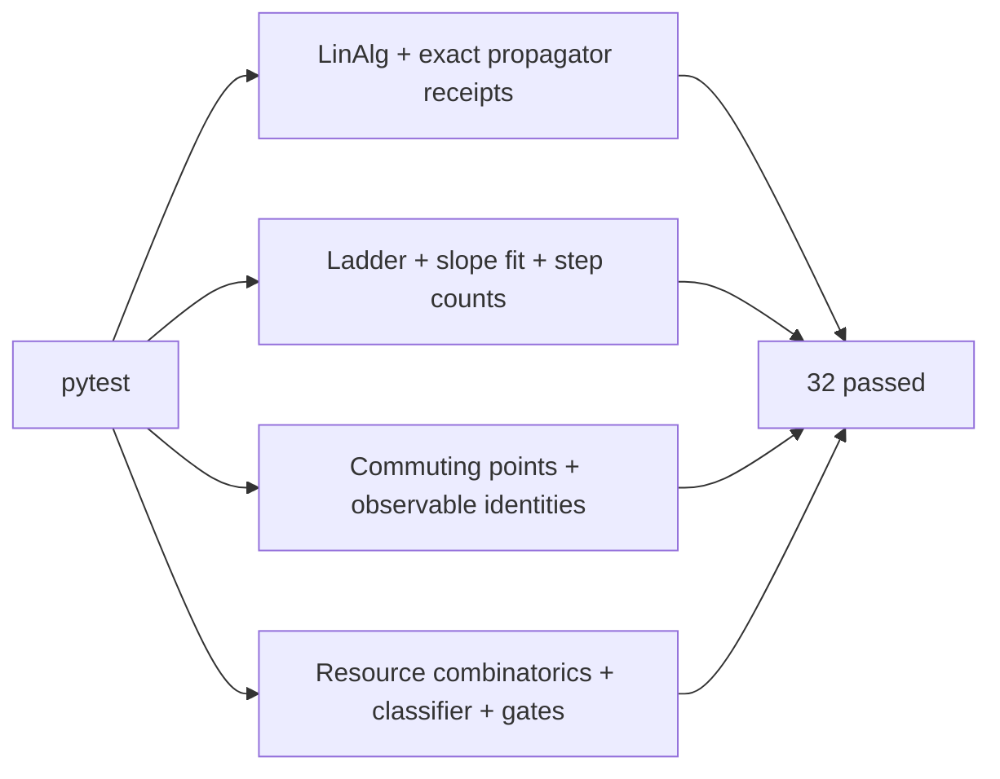
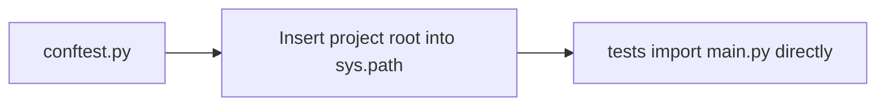
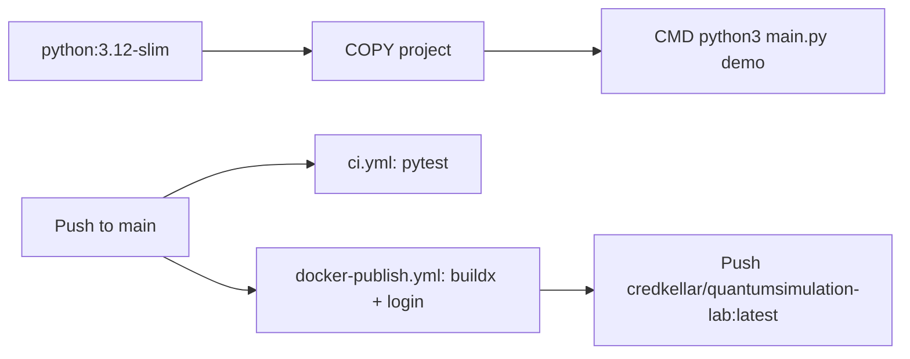

# QuantumSimulation-Lab ⚛️🌀

**Digital Quantum Simulation Lab — Trotter–Suzuki Error, Measured** — by Darion Kellar

QuantumSimulation-Lab is an **educational digital quantum simulation lab** in ONE pure-Python file. It classically simulates the **transverse-field Ising chain** — `H = −J Σ Z_i Z_{i+1} − h Σ X_i` on an open chain of **N = 3 and N = 4 spins** (Hilbert dimensions 8 and 16) — with everything built from scratch: Kronecker products, the exact propagator `U(t) = exp(−iHt)` by scaling-and-squaring Taylor, first-order (Lie) and second-order (Strang) Trotter–Suzuki product formulas whose factors are exponentiated exactly, and an operator norm by power iteration. 🔬

The lab's real subject is **error bookkeeping**. The Trotter error is *measured* against the exact propagator in operator norm, the log-log slope is *fitted* and graded against theory (−1.0074 measured vs −1 for Lie; −2.0064 vs −2 for Strang), and the step count each order needs to reach error < 1e-6 at t = 1 is printed with its provenance: **1,069 steps for Strang, verified directly** (measured error 9.96e-07), versus **1,282,892 steps for Lie, extrapolated from the fit and flagged as such** — running a million 16×16 matrix multiplies to confirm a fit is minutes of CPU, and the lab says so instead of pretending.

Honest scope, stated up front: N ≤ 4 spins simulated on a classical laptop is **not a quantum computer and claims no speedup**. No hardware is touched, no molecule or material is discovered, and a 4-spin chain says nothing by itself about the thermodynamic limit. Every speedup / hardware / chemistry / materials / vendor / cryptanalysis claim sits behind a permanent HOLD gate (14 total). 🔒

[](https://github.com/kimanicollier44-cmyk/QuantumSimulation-Lab/actions/workflows/ci.yml)
[](https://github.com/kimanicollier44-cmyk/QuantumSimulation-Lab/actions/workflows/docker-publish.yml)

> ℹ️ These are the **live** workflow badges for this repo. They activate as soon as the `ci.yml` and `docker-publish.yml` files from the paste pack are pasted into `.github/workflows/` — until then they have nothing to report yet.

## 🧰 Tech Stack Badges & Full Architecture Tech Stack

### 💻 Core Programming Languages & Core Systems


- 🐍 Python 3.12, pure standard library (`math`, `cmath`, `hashlib`, `json`, `sys`) — zero dependencies, zero network, deterministic (double-run byte-identical)
- 🧮 Linear algebra from scratch: Kronecker products, matrix multiply / dagger / Frobenius norm as plain lists of complex numbers, the matrix exponential by scaling-and-squaring Taylor (stated openly, graded by unitarity 4.88e-15), and the operator norm by power iteration on `M†M` with two deterministic start vectors
- 🌀 Trotter–Suzuki core: the ZZ factor exponentiated exactly as diagonal phases, the X factor as a Kronecker product of per-qubit rotations `cos(hτ) I + i sin(hτ) X`, assembled as full-matrix products — Lie `exp(−iBτ) exp(−iAτ)` and Strang `exp(−iAτ/2) exp(−iBτ) exp(−iAτ/2)`
- 📉 Error analysis: operator-norm error ladder n = 1..128 at fixed t, log-log slope fitted over the asymptotic region (n ≥ 4) and asserted against theory in CHECKS, steps-to-target verified by fit-guided bisection where affordable and flagged EXTRAPOLATED where it is not
- 🧠 TinyML kNN regime classifier (from scratch, stdlib, distance-weighted): converged / trotter-limited / deep-circuit / trivially-exact from (error, steps, order, h/J), labels from the lab's own policy
- 🪑 Council seats: Gemini Argon 4 DECIDER (names-only, tighten-only) + Muse advisor (never overrides HOLD) + Google Flow plan-only (rendered = False, live = 0)

### ⛓️ Web3 & Infrastructure

- 🚫 **Not applicable — honestly.** No blockchain, no Web3, no tokens: the "infrastructure" in this lab is one offline file holding a 16×16 Hamiltonian, two product formulas, and an error ladder. Quantum speedup and cryptanalysis claims are permanent HOLD gates, not features. No fake badges here.

### ⚙️ Platform Support & Hardware Architecture


- 🖥️ Pure Python — runs anywhere Python 3.12+ runs (Linux, macOS, Windows), plus the `python:3.12-slim` Docker image
- 🔒 No quantum hardware is touched, ever: real devices, circuit execution, and hardware specifications are permanent HOLD gates (see the gate table below). This lab *simulates* a quantum algorithm classically; it does not run one

### ⚡ Low-Level Infrastructure & Performance

- 🚫 **No low-level code — honestly.** No C, no C++, no GPU, no compiled extensions: this is one interpreted Python file on purpose, so every matrix entry can be read, checked, and diffed. Performance here means honest algorithms — a scaling-and-squaring exponential, power iteration for the operator norm, and a fit-guided bisection for the verified step count — all deterministic and byte-identical between runs

### 🛠️ DevOps & Build Tools


- 🐳 Docker (`python:3.12-slim`), GitHub Actions CI + Docker Publish (delivered in the paste pack)
- 🎯 Target image: `credkellar/quantumsimulation-lab:latest`
- 🧪 Tests: `pytest` (32 tests) + the built-in CHECKS suite (57 checks) in `main.py`

### ☁️ Cloud Providers

- 🚫 **None — honestly.** No cloud provider is used or needed: the lab runs fully offline on your own machine or in a local Docker container. Docker Hub appears only as the registry the publish workflow pushes the image to.

## What this does?

1. 🏗️ **The chain, built by hand** — the transverse-field Ising Hamiltonian `H = −J Σ Z_i Z_{i+1} − h Σ X_i` (open chain, J = 1, labelled h) is assembled from Kronecker products written in this file: dim 8 for N = 3, dim 16 for N = 4. The lab prints its receipts: trace(H) = 0 exactly, ‖H‖_F = 10.5830, and ‖[A, B]‖_F = 19.5959 — the ZZ part and the X part **do not commute**, which is the entire reason Trotter error exists.
2. 🎯 **Exact reference propagator** — `U(t) = exp(−iHt)` by scaling-and-squaring Taylor (the method is stated in the docstring, not hidden): unitarity deviation **4.88e-15**, roundtrip `U(t)U(−t) = I` to 4.88e-15, state norms conserved to machine precision. ⟨Z_0⟩(t = 1) from |0000⟩ = **−0.033022**.
3. 🪜 **The Trotter ladder** — operator-norm error vs the exact propagator at t = 1, n = 1..128: order 1 falls 1.845492 → 0.010793, order 2 falls 1.534259 → 6.94410e-05. At n = 16 Strang (0.004451) is already **19×** more accurate than Lie (0.086520).
4. 📉 **Slopes, fitted and graded** — the log-log fit over n ≥ 4 gives **−1.0074** for Lie (theory −1, prefactor 1.4236) and **−2.0064** for Strang (theory −2, prefactor 1.1674). CHECKS assert both slopes within 0.15 of theory and that the fit reproduces the measured n = 128 errors within 35% — the scaling law is measured, not quoted.
5. 🔢 **Steps to target, with provenance** — to reach error < 1e-6 at t = 1: Strang needs **1,069 steps, verified directly** (the count was bisected against measured errors; at 1,069 the measured error is 9.96e-07). Lie needs **1,282,892 steps by fit extrapolation — flagged EXTRAPOLATED everywhere it appears**, because running it would take minutes of CPU to confirm what the fit already shows.
6. 🧲 **Observables, with a trap found and named** — ⟨Z_0⟩(t) and ⟨X_0⟩(t) from |0000⟩ and the Néel state |0101⟩, exact vs both orders at n = 8. The trap: the two states' ⟨Z_0⟩ curves are **identical**, and Lie and Strang agree on ⟨Z_0⟩ to machine precision at equal n — Strang's half-step ZZ layers are diagonal phases, invisible to a diagonal observable from a Z-basis state. ⟨X_0⟩ is the observable that separates the orders: max deviation **0.063940 (Lie) vs 0.007016 (Strang)**, and ⟨X_0⟩(t = 1) = +0.499309 from |0000⟩, −0.499309 from Néel.
7. 🎛️ **The commuting points are exact** — at h = 0 there is no X part and at J = 0 there is no ZZ part, so any Trotter split is exact by construction: measured errors **7.85e-16** (h = 0, Lie, n = 3) and **1.57e-15** (J = 0, Strang, n = 3), asserted in CHECKS. The sweep also shows Strang's n = 16 error growing with field (1.45e-15 at h = 0 → 0.010762 at h = 2) while Lie's saturates around 0.07–0.10, and the N = 3 chain erring slightly less than N = 4 (0.003332 vs 0.004451, Strang at n = 16).
8. 🧾 **Resource ledger** — rotations counted combinatorially for the open chain (N − 1 = 3 ZZ rotations and N = 4 X rotations per layer; Strang's neighbouring half-layers merge, so n Strang steps cost n + 1 ZZ layers, not 2n). To reach 1e-6: Lie = 3,848,676 ZZ + 5,131,568 X = **8,980,244 rotations**; Strang = 3,210 ZZ + 4,276 X = **7,486 rotations** — a **1,199.6×** ratio. Counted, none executed.
9. 🏷️ **Regime classifier** — a from-scratch distance-weighted kNN labels (error, steps, order, h/J) points converged / trotter-limited / deep-circuit / trivially-exact from the lab's own policy: Strang at target is converged, Lie at n = 8 is trotter-limited, Lie's million-step road to 1e-6 is deep-circuit, and the zero-field point is trivially-exact. kNN == policy is asserted on every scenario and all 336 training-grid rows.
10. 🔒 **Seats, gates, checks** — Gemini Argon 4 DECIDER (sha256 trace, tighten-only), Muse advisor, Google Flow plan-only, 14 permanent HOLD gates (speedup, hardware, chemistry, materials, vendor benchmarks, cryptanalysis, thermodynamic-limit claims…), and a built-in CHECKS suite (57 checks) that re-derives every headline number above.

## 🗺️ How it works — diagram per script

### `main.py` — the whole lab



### `tests/test_main.py` — verification



### `conftest.py` — test path setup



### `Dockerfile` + CI flow — container & publish



## Why is this cool?

1. 📉 The scaling law is **measured, not quoted**: the fitted slopes land at −1.0074 and −2.0064 against theory's −1 and −2, and the fit is graded against the ladder it came from.
2. 🔢 The two step counts carry **different kinds of honesty**: 1,069 is verified by direct measurement; 1,282,892 is labelled EXTRAPOLATED in every printout — the lab never lets an estimate wear a measurement's clothes.
3. 🧲 The observable section **catches its own trap**: ⟨Z_0⟩ cannot tell Lie from Strang at all (diagonal phases cancel), and the lab proves it numerically, explains why, and grades ⟨X_0⟩ instead — a lesson most Trotter demos never teach.
4. 🎯 The exact reference is **receipted, not trusted**: unitarity 4.88e-15, roundtrip 4.88e-15, traceless H, and a nonzero commutator norm (19.5959) printed as the reason error exists at all.
5. 🧾 The resource ledger prices order in **rotations, not adjectives**: 8,980,244 vs 7,486 — a 1,199.6× ratio computed from combinatorics, including the Strang half-layer merge (n + 1 layers, not 2n).
6. 🎛️ The commuting points are **exact and asserted**: at h = 0 or J = 0 the split has nothing to fight about, and the measured errors (7.85e-16, 1.57e-15) are machine-zero, not small.
7. 🌀 The whole simulation is **written out**: Kronecker products, the exponential, the operator norm — no library call hides a single operation the lab claims to perform.
8. 🏷️ The classifier's labels come from the **lab's own policy** and kNN == policy is asserted on all 336 grid rows — interpolation is checked, not assumed.
9. 🔒 The scope fence is **structural**: "quantum speedup" is a HOLD gate that exits 2, because a classical 4-qubit simulation claiming speedup would be the one truly wrong result.
10. 🎯 Deterministic end to end: run it twice, get byte-identical output — a Trotter error ladder you can diff.

## What problems this solves?

1. ❌ **Problem:** "Second-order Trotter is better" is usually asserted, not measured. ✅ **Solution:** Both orders are run against the same exact propagator; the ladder, the fitted slopes, and the step counts are the measurement.
2. ❌ **Problem:** Error exponents get quoted from textbooks for other people's Hamiltonians. ✅ **Solution:** The slope is fitted on *this* chain at *these* parameters (n ≥ 4, t = 1, h = 1) and asserted within 0.15 of theory in CHECKS.
3. ❌ **Problem:** Steps-to-target numbers are often extrapolations wearing a measurement's clothes. ✅ **Solution:** Strang's 1,069 is bisected against directly measured errors; Lie's 1,282,892 is flagged EXTRAPOLATED in the demo, the JSON, and this README.
4. ❌ **Problem:** Observable plots can hide a product formula's error completely. ✅ **Solution:** The lab shows ⟨Z_0⟩ agreeing between orders to machine precision, explains the diagonal-phase cancellation, and grades the orders on ⟨X_0⟩, which actually separates them (~9× at n = 8).
5. ❌ **Problem:** "Exact" reference propagators are usually a library's black box. ✅ **Solution:** The exponential is written out (scaling-and-squaring Taylor, stated in the docstring) and graded by unitarity and roundtrip identities, not by trust.
6. ❌ **Problem:** Gate counts for Strang are often doubled by sloppy bookkeeping. ✅ **Solution:** The ledger counts merged half-layers — (n + 1)(N − 1) ZZ rotations for n steps — and asserts the combinatorics in CHECKS.
7. ❌ **Problem:** Simulation demos quietly imply quantum advantage. ✅ **Solution:** The first demo section states the classical scope, and `quantum_speedup_claim` is a permanent HOLD gate returning exit code 2.
8. ❌ **Problem:** Finite-size results get silently extrapolated to real materials. ✅ **Solution:** N = 3 vs N = 4 are both shown, and `thermodynamic_limit_claim` is a HOLD gate — 4 spins describe 4 spins.
9. ❌ **Problem:** The field-dependence of Trotter error is rarely shown. ✅ **Solution:** The h sweep prints both orders at five fields, including the exact h = 0 point and Lie's saturation around 0.07–0.10.
10. ❌ **Problem:** Chemistry and hardware claims leak out of teaching simulations. ✅ **Solution:** 14 named HOLD gates cover chemistry, materials, drug, vendor-benchmark, hardware-spec, and cryptanalysis claims, permanently.

## How to install this?

1. 📋 Clone or download this project folder.
2. 🐍 Make sure Python 3.12+ is installed: `python3 --version`
3. ▶️ Run the full demo + checks (no arguments needed):

```bash
python3 main.py
```

4. 🧪 Run the test suite:

```bash
pip install pytest
python3 -m pytest -q
```

5. 🎛️ Try the other commands:

```bash
python3 main.py checks      # 57 built-in checks
python3 main.py exact       # Hamiltonian + exact propagator receipts (JSON)
python3 main.py trotter     # error ladder, slope fits, steps to 1e-6 (JSON)
python3 main.py observable  # <Z_0> / <X_0> curves, exact vs Trotter (JSON)
python3 main.py resources   # rotation ledger to reach 1e-6 (JSON)
python3 main.py sweeps      # h sweep, N sweep, commuting points (JSON)
python3 main.py classify    # kNN regime classifier report
python3 main.py brains      # Argon 4 + Muse + Flow seats
python3 main.py holds       # list all 14 HOLD gates
python3 main.py hold-demo   # exits 2 - gated actions stay HOLD
```

6. 🐳 Or run it in Docker:

```bash
docker build -t credkellar/quantumsimulation-lab:latest .
docker run --rm credkellar/quantumsimulation-lab:latest
```

## Requirements

- 🐍 Python 3.12 or newer
- 📦 Dependencies: **none** (standard library only)
- 🌐 Network: **none** — fully offline
- 🧪 For tests only: `pytest`
- 🐳 Optional: Docker

## FULL project structure tree

```text
quantumsimulation-lab/
├── main.py                  # the whole lab: lin-alg kit, TFIM chain, exact propagator, Trotter factors, error ladder + fits, observables, resource ledger, sweeps, classifier, seats, HOLD gates
├── conftest.py              # puts the project root on sys.path for tests
├── tests/
│   └── test_main.py         # 32 pytest tests: lin-alg, exact receipts, ladder, slopes, step counts, commuting points, observable identities, resources, gates, determinism
├── assets/
│   └── cover.png            # README cover image (2736 x 912)
├── Dockerfile               # python:3.12-slim, runs the demo
├── .gitignore               # __pycache__/, .pytest_cache/, *.pyc
└── README.md                # this file
```

> 📦 Delivered separately as paste packs (not in this tree): `.github/workflows/ci.yml` + `docker-publish.yml`, and the Docker Hub pack (100-char description, 350-char About, overview, categories).

## 🔒 HOLD gates — all 14, permanent

| # | Gate | What stays held |
|---|------|-----------------|
| 1 | `quantum_speedup_claim` | No quantum speedup claim; this is a classical simulation of at most 4 qubits |
| 2 | `real_hardware_execution` | No executing circuits on real quantum hardware from this lab |
| 3 | `hardware_specification_claim` | No qubit counts, coherence times, or fidelity specs for real devices |
| 4 | `chemistry_discovery_claim` | No claiming a molecule was discovered or a chemical property certified |
| 5 | `materials_design_claim` | No claiming a material was designed or its properties certified by this sim |
| 6 | `drug_discovery_claim` | No drug-discovery or pharmacology claims from a 4-spin teaching model |
| 7 | `vendor_benchmark_claim` | No vendor benchmark comparisons or device rankings |
| 8 | `cryptanalysis_claim` | No claims about breaking encryption or cryptographic timelines |
| 9 | `error_correction_deployment` | No fault-tolerance or quantum-error-correction readiness claims |
| 10 | `commercial_product_claim` | No commercial quantum product or service claims from a lab model |
| 11 | `investment_claim` | No investment claims; a teaching simulation is not a prospectus |
| 12 | `certified_accuracy_claim` | No certifying these results as physically exact for any real system |
| 13 | `weapons_defense_application` | No weapons, targeting, or defense application claims |
| 14 | `thermodynamic_limit_claim` | No claiming N ≤ 4 finite-chain results describe the thermodynamic limit or real phase transitions |

🧑‍⚖️ **Council seats:** Gemini Argon 4 Extended Thinking — DECIDER (names-only, tighten-only, MAP → MODEL → STRESS → DECIDE, sha256 trace, `can_override_hold = False`) · Muse — advisor (`can_override_hold = False`) · Google Flow — plan-only (`rendered = False`, `live = 0`).

✅ **Verification:** pytest **32 passed** (project + clean copy) · built-in CHECKS **57/57** · double-run output **byte-identical** · `hold-demo` exits **2** · `main.py` **1,027 lines**, pure stdlib, zero network.

## 🧒 5th-grade English section

Imagine you want to copy a dance move exactly, but you can only practice it in little pieces. 💃

- A **quantum computer** would do the dance natively. This lab is a normal computer *pretending* to be a tiny quantum one — only 4 pretend atoms (called spins), each one a little arrow that can point up or down and tug on its neighbours. 🧲
- The pretend atoms follow one rule with two parts that **fight each other**: neighbours want to point the same way, but a sideways wind keeps flipping them. Because the two parts fight, you cannot do the whole dance in one go — you chop time into tiny steps and alternate the parts. That chopping is called **Trotterisation**, and every chop leaves a small mistake. ✂️
- This lab **counts the mistakes honestly**. It knows the perfect dance (computed very carefully), then measures how wrong the chopped versions are. Chopping the simple way, the mistake shrinks slowly — like halving when you double the steps. Chopping the clever symmetric way, the mistake shrinks **four times faster** each doubling. The lab draws the falling mistake lines and checks their steepness against the theory. 📉
- To make the mistake teeny-tiny (smaller than one in a million), the simple way needs about **1.28 million steps** — the lab did not run all million; it measured the pattern and *says* that number is an estimate. The clever way needs only **1,069 steps**, and that one the lab really ran and checked. 🏃
- Sneaky catch: if you only watch whether the first arrow points up or down, the simple and clever dances look **exactly the same** — the lab figured out why (part of the clever dance only adds invisible twirls for that measurement) and picked a different thing to watch that tells them apart. 👀
- This project is a **pretend lab on a computer**. It does not run a real quantum computer, discover medicine, or break secret codes — those doors are locked on purpose. It teaches how scientists chop time, count mistakes, and prove the count is right. 💻

---

MIT © 2026 Darion Kellar · QuantumSimulation-Lab — educational simulation only ⚛️
